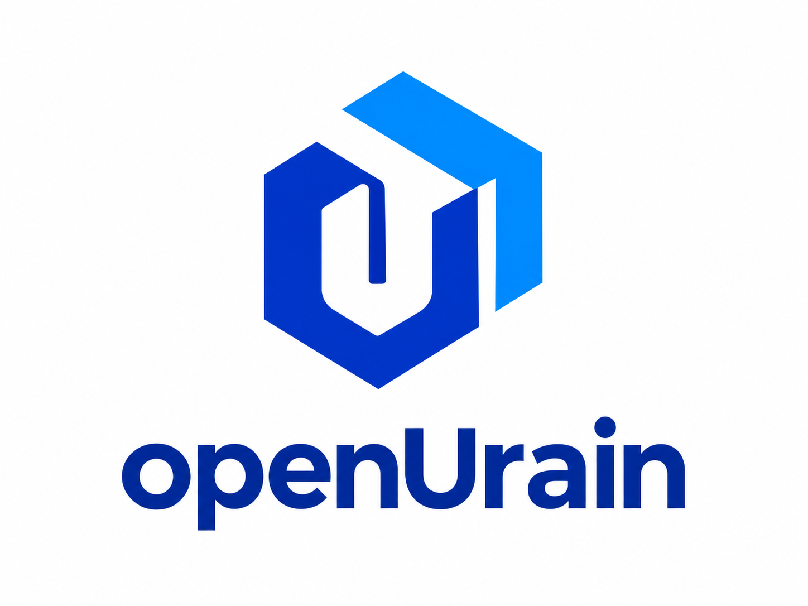

  

<h1 align="center">让需求有回应，让开源更好用</h1>

面向真实需求 · 打造实用软件 · 社区共同成长

---

## 关于 openUrain

openUrain 是一个致力于开源软件开发的组织。我们从市场与用户的真实需求出发，打造稳定、易用的软件，让技术在实际场景中发挥价值。

## 我们关注

- 🎯 **真实需求**：关注市场变化与用户反馈，从实际问题出发寻找解决方案。
- 🛡️ **稳定可靠**：重视软件质量和持续维护，让每一次使用更安心。
- ✨ **简单易用**：关注细节和使用体验，降低上手与使用的门槛。
- 🤝 **开放协作**：分享想法、交流经验，在共建中持续改进。

## 一起参与

欢迎浏览感兴趣的项目，并通过适合你的方式参与：

- 💡 参与讨论，分享需求与建议。
- 🐛 反馈问题，提交issues，提供复现步骤或使用场景。
- 🧩 改进文档、修复问题，或通过PR贡献代码。

你可以在对应的项目仓库中通过 Issue 或 Pull Request 与我们交流。参与前，也欢迎先阅读项目的 README 和贡献指南。

---

从真实需求出发，让好的想法成为好用的软件。

