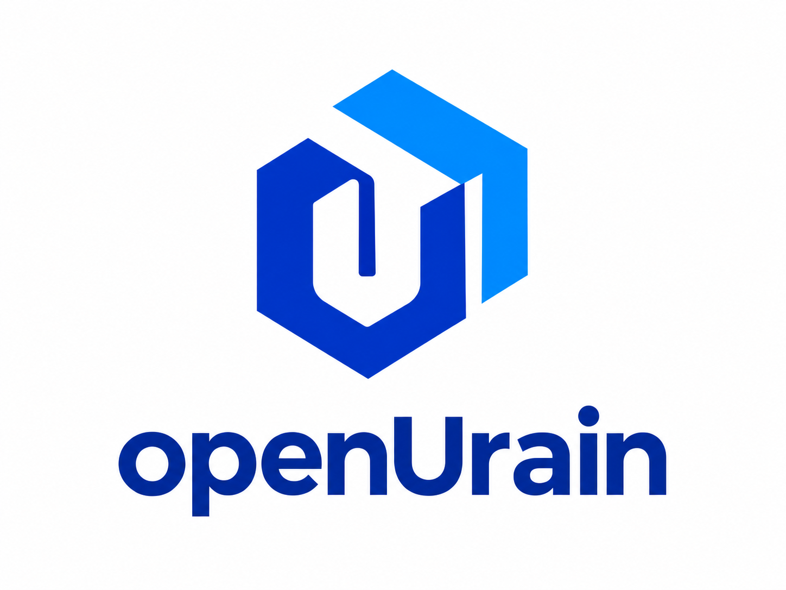
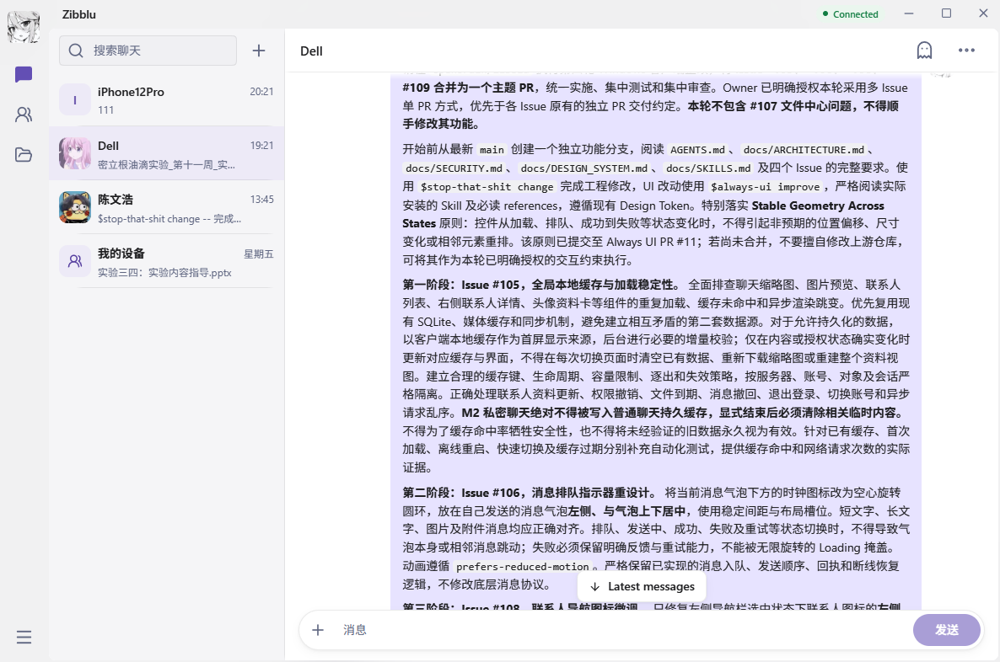

<h1 align="center">让需求有回应，让开源更好用</h1>

面向真实需求 · 打造实用软件 · 社区共同成长

<a href="https://openurain.com/">官方网站</a> · <a href="https://openurain.com/products">探索产品</a> · <a href="https://github.com/openUrain">GitHub</a>

## 我们的产品

### Zibblu — Chat freely. Share privately.

轻量级开源即时通信软件，融合日常聊天、可靠文件分享、局域网加密私密文字会话，以及按需授权的只读 AI 助手。普通在线聊天不属于端到端加密；详情见项目的安全说明。

[**产品官网**](https://zibblu.openurain.com/) · [GitHub 仓库](https://github.com/openUrain/Zibblu) · [下载 Windows 版](https://github.com/openUrain/Zibblu/releases/latest) · [安全边界](https://github.com/openUrain/Zibblu/blob/main/docs/SECURITY.md)

---

## 我们关注

| 🎯 真实需求 | 🛡️ 稳定可靠 |
| --- | --- |
| 从实际问题出发，认真听取用户反馈。 | 重视软件质量、数据安全和持续维护。 |
| **✨ 简单易用** | **🤝 开放协作** |
| 降低使用门槛，让细节服务于真实工作。 | 分享想法、交流经验，在共建中持续改进。 |

## 一起参与

欢迎在对应项目的 Issue 分享需求、反馈可复现的问题，或通过 Pull Request 改进代码和文档。参与前请阅读项目 README 和协作指南。

[反馈 Zibblu 问题](https://github.com/openUrain/Zibblu/issues) · [浏览组织仓库](https://github.com/orgs/openUrain/repositories)

---

从真实需求出发，让好的想法成为好用的软件。

